# 11-апта: текстуралар

**Тақырыбы:** суретті файлдан жүктеу (stb_image), текстура объектісін құру,
UV координаттары, орау режимдері (wrap), сүзгілер (filter), mipmap.

Негізі — 10-аптадағы еркін камера (`main.cpp`). Кубтар енді түспен емес,
`assets/container.png` суретімен боялған.

## Құрастыру және іске қосу

```bash
cmake -S . -B build
cmake --build build
./build/bin/cg                 # қалыпты режим
./build/bin/cg --screenshots   # screenshots/ ішіндегі суреттерді қайта түсіреді
```

`glad` пен `stb` (`stb_image.h`, `stb_image_write.h`) `external/` бумасында тұр.
Суреттердің жолы `ASSET_DIR` арқылы беріледі (CMakeLists.txt). Сондықтан
бағдарламаны қай бумадан іске қоссаң да сурет табылады.

Іске қосқанда терминалға мына жазу шығады:

```
.../assets/container.png  512x512  арна: 3
```

## Басқару

| Перне | Әрекет |
|---|---|
| Тінтуір / дөңгелек | қарау / fov (zoom) |
| W A S D, Space, Left Ctrl, Shift | жүру, жоғары, төмен, жүгіру |
| **1 2 3 4** | орау: `GL_REPEAT` / `GL_MIRRORED_REPEAT` / `GL_CLAMP_TO_EDGE` / `GL_CLAMP_TO_BORDER` (1-тапсырма) |
| **U** | `vertices[]` ішіндегі UV: × 1.0 → × 2.0 → × 0.1 (1, 2-тапсырма) |
| **N** | MAG сүзгісі: `GL_LINEAR` ↔ `GL_NEAREST` (2-тапсырма) |
| **B** | MIN сүзгісі: `GL_LINEAR_MIPMAP_LINEAR` ↔ `GL_LINEAR` (3-тапсырма) |
| **K** | MAG-қа mipmap тұрақтысы, әдейі қате (4-тапсырма) |
| **X** | `glGenerateMipmap`-сыз жүктелген текстура: қара куб (4-тапсырма) |
| **[ / ]** | `uvScale` 0.5 … 8.0 (5-тапсырма) |
| **O** | өз суретім, 4 арналы PNG (Қ1) |
| **T** | tint: түспен көмкеру (Қ2) |
| **F** | ағып жатқан су (Қ3) |
| **G / H** | анизотропты сүзгі / үлкен жалпақ еден (Қ4) |
| P | камера мен текстураның толық күйі |
| R | камераны бастапқы күйге қайтару |
| L / I / M | pitch шектеуі / invert Y / тінтуір режимі |
| F12 / ESC | скриншот / шығу |

Терезе тақырыбында ағымдағы орау режимі, сүзгілер, UV және `uvScale` көрінеді.

## Базалық бөлім

* `#define STB_IMAGE_IMPLEMENTATION` + `#include <stb_image.h>` файлдың басында.
* `vertices[]`: әр вершинада `x y z u v`. Stride **екі жерде де** `5 * sizeof(float)`,
  UV атрибуты `location = 1`, 2 компонент.
* Алты жақтың UV реті бірдей: `(0,0) (1,0) (1,1)` және `(0,0) (1,1) (0,1)`.
  10-аптадағы түсті кубта әр жақтың бұрыштары әртүрлі ретпен жазылған еді.
  Түс үшін бұл маңызды емес, ал UV үшін бір бұрышқа екі түрлі UV түсіп, сурет
  бұзылатын. Сондықтан әр жақтың бұрыштары бір үлгіге келтірілді:
  *сол-асты, оң-асты, оң-үсті | сол-асты, оң-үсті, сол-үсті*. Сырттан
  қарағанда бұл CCW, сондықтан culling ешбір жақты жоғалтпайды.
* Фрагмент шейдері: `texture(ourTexture, uv)`. `texture2D` 3.3 Core-да жоқ.
* `loadTexture()`: `stbi_set_flip_vertically_on_load(true)`, арна санына қарай
  `GL_RGB`/`GL_RGBA`, `glGenerateMipmap` `glTexImage2D`-ден **кейін**,
  `stbi_image_free`.
* Render циклінде: `glActiveTexture(GL_TEXTURE0)` + `glBindTexture`,
  `ourTexture` sampler-і 0-бірлікке байланған.

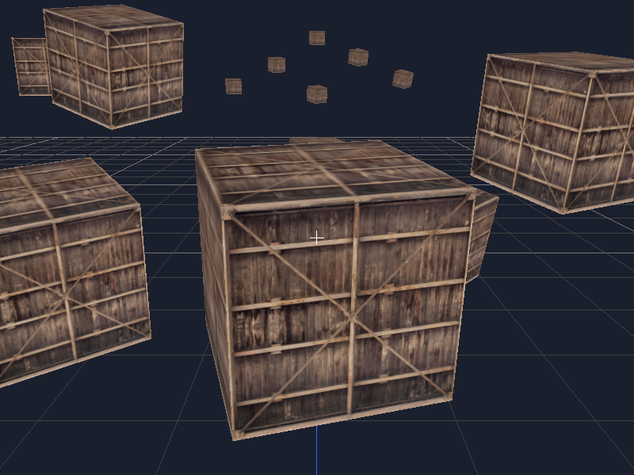

## 1-тапсырма: орау режимдері

`vertices[]` ішіндегі UV 2.0-ге көбейтілді (U пернесі). Енді UV 0…2 аралығында,
ал сурет 0…1-ді алады. 1…2 бөлігін қалай толтыратынын орау режимі шешеді.

| GL_REPEAT | GL_MIRRORED_REPEAT |
|---|---|
| 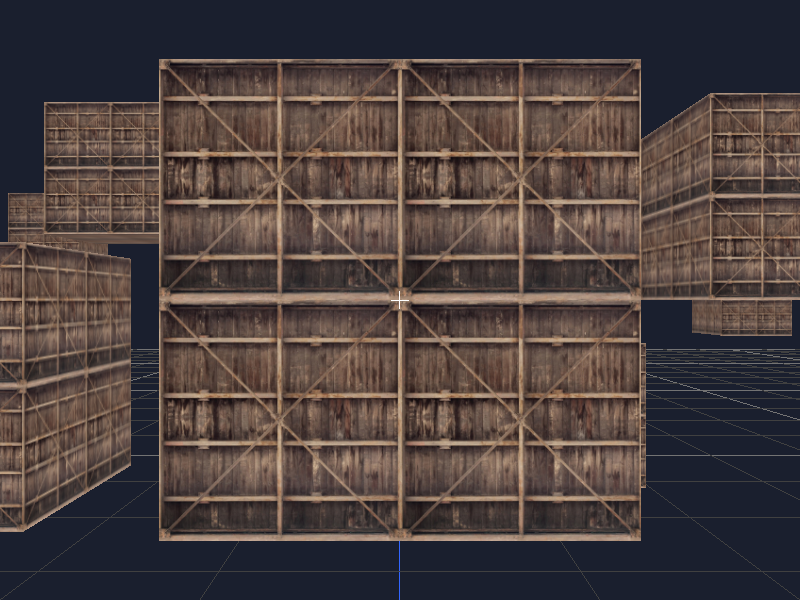 | 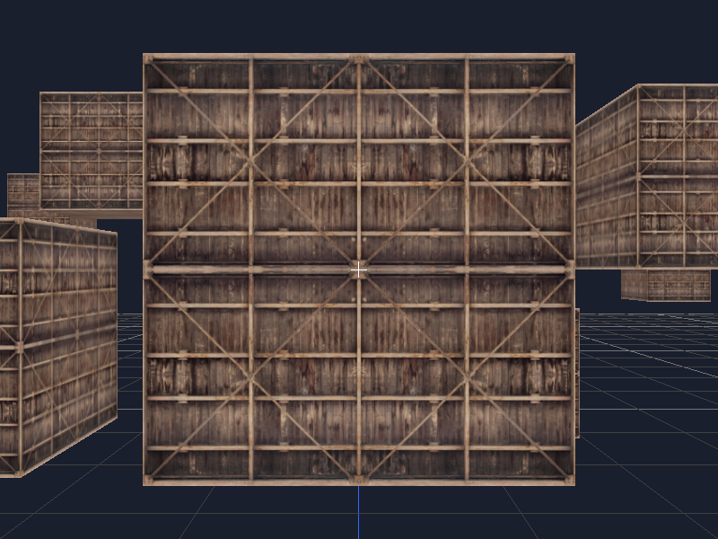 |
| **GL_CLAMP_TO_EDGE** | **GL_CLAMP_TO_BORDER** (қызыл шекара) |
| 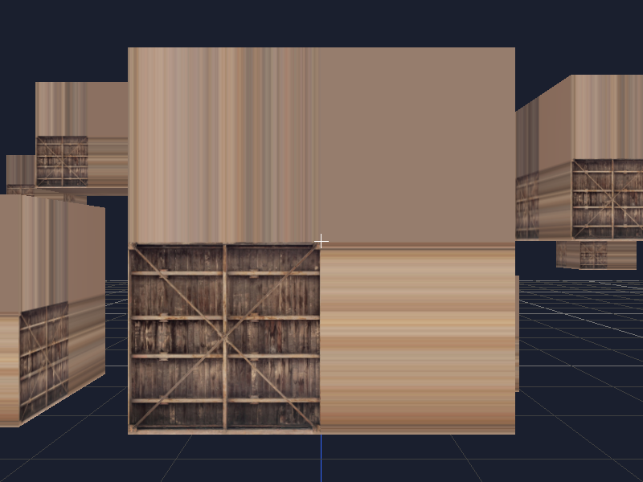 | 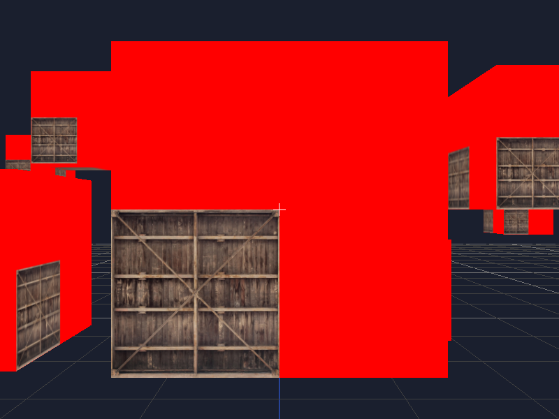 |

**Қай режим қай жағдайға қолайлы:**

* **GL_REPEAT**: шеттері бір-біріне жалғасатын (tileable) текстуралар: еден,
  қабырға, кірпіш, шөп, жер. Үлкен бетті кішкене суретпен жабу.
* **GL_MIRRORED_REPEAT**: шеттері жалғаспайтын сурет қайталанса. Көршілес
  көшірмелер айналып тұрғандықтан шекарада тігіс болмайды. Табиғи, симметриясы
  байқалмайтын беттерге (құм, тас, бұлт) жарайды. Жазуы бар суретке жарамайды,
  жазу кері шығады.
* **GL_CLAMP_TO_EDGE**: сурет бір рет қана салынуы керек болса: UI элементтері,
  спрайттар, skybox жақтары, декаль. Шеттегі пиксельдер созылады, бірақ
  қарсы шеттің пикселі "ағып" кірмейді (REPEAT-та LINEAR сүзгісі қарсы шетті
  араластырып жібереді).
* **GL_CLAMP_TO_BORDER**: 0…1-ден тыс аймақтың түсі нақты белгілі болса:
  shadow map (тыс жерде көлеңке жоқ = ақ), проекцияланатын текстура (фонарь
  жарығы, декаль), шекараны көзбен көру/жөндеу.

**Қорғауға: REPEAT пен MIRRORED_REPEAT айырмашылығы.** Айырмашылық көшірмелердің
**түйіскен жерінде**, UV = 1.0 сызығында көрінеді. REPEAT-та суреттің оң шеті
келесі көшірменің сол шетіне тиеді, яғни екі **түрлі** шет қатар тұрады. Шеттері
сәйкес келмейтін суретте тігіс байқалады, мұнда екі рамка қатар тұрып, ортада
қалың сызық шығады (02-repeat.png). MIRRORED_REPEAT-та келесі көшірме айналған,
сондықтан шет **өзімен-өзі** түйіседі де, тігіс болмайды. Есесіне сурет
симметриялы болады (диагональдар "ромб" құрайды, 03-mirrored.png).

## 2-тапсырма: NEAREST пен LINEAR

UV 0.1-ге кішірейтілді (U пернесін екі рет басу), яғни суреттің 51×51 texel-дік
бұрышы бүкіл жаққа созылды. Бір қашықтық, fov 20°:

| GL_NEAREST | GL_LINEAR |
|---|---|
| 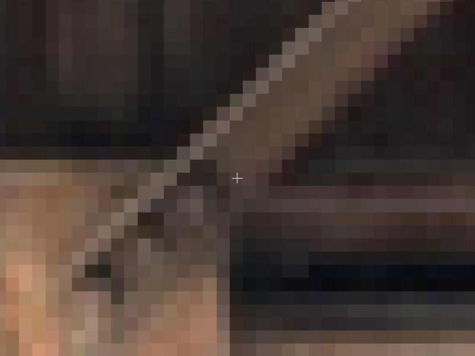 | 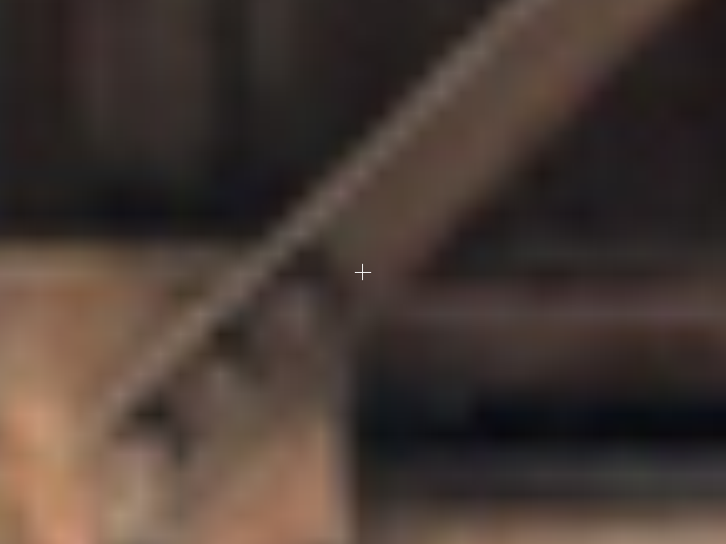 |

NEAREST ең жақын бір texel-ді алады, сондықтан анық шаршылар көрінеді. LINEAR
көршілес 4 texel-ді қашықтығына қарай араластырады, сондықтан ауысу жұмсақ,
бірақ сурет бұлдыр.

**Қорғауға.** Пиксель-арт ойынында **GL_NEAREST**: суретші әр пиксельді
әдейі салған, шекаралары өткір болуы керек. LINEAR оларды бұлдыратып, "сабын"
сияқты етеді. Фотореалистік ойында **GL_LINEAR** (MIN-де mipmap-пен және
анизотропиямен бірге): шынайы беттерде пиксель шаршылары көрінбеуі керек,
жұмсақ ауысу табиғи көрінеді.

## 3-тапсырма: mipmap

`cubePositions[]` массивіне z = −40 маңында алты куб қосылды. Камера олардан
~32 бірлік қашықтықта, жерде үлкен жалпақ еден-куб (H) бар.

| GL_LINEAR (mipmap жоқ) | GL_LINEAR_MIPMAP_LINEAR |
|---|---|
| 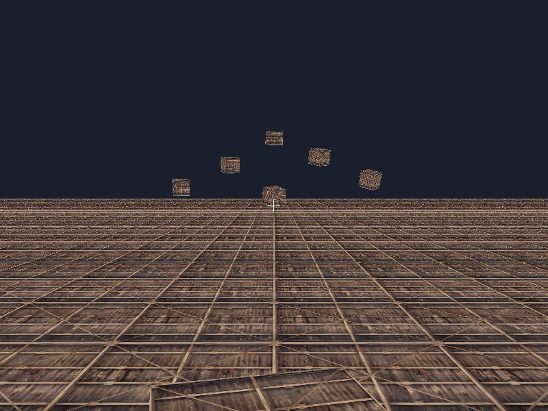 | 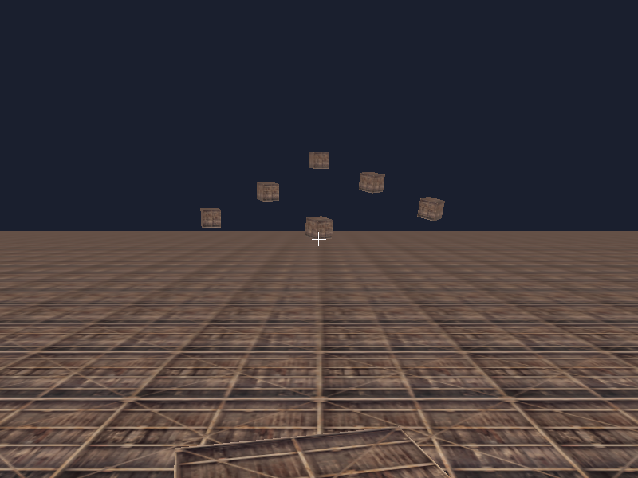 |

**Айырмашылық:** mipmap-сыз алыстағы кубтар мен еденнің алыс бөлігі "құмды"
шуға және муар жолақтарына айналады, камера қозғалғанда жыпылықтайды. Mipmap-пен
олар біркелкі, сәл бұлдыр, бірақ тыныш көрінеді.

**Қорғауға: бір фрагментке неше texel келеді.**
512×512 текстура экранда 20×20 пиксельге сығылса:

```
бір ось бойынша:   512 / 20 = 25.6 texel бір пиксельге
ауданы бойынша:    25.6 × 25.6 ≈ 655 texel бір фрагментке
```

`GL_LINEAR` осы ~655 texel-дің тек **4-еуін** оқиды, қалғаны еленбейді. Қай
4-еуі түсетіні камераның кішкене жылжуынан өзгереді, сондықтан түс кадр сайын
секіреді. Бұл жыпылықтау (aliasing).

Mipmap деңгейлері: 512 → 256 → 128 → 64 → **32** → **16** → … GPU фрагменттің
өлшеміне сай деңгейді таңдайды: `log2(25.6) ≈ 4.68`, яғни 4-деңгей (32×32) мен
5-деңгейдің (16×16) арасы:

```
32×32 деңгейінде:  32 / 20 = 1.6  →  1.6² ≈ 2.6 texel фрагментке
16×16 деңгейінде:  16 / 20 = 0.8  →  0.8² ≈ 0.64 texel фрагментке
```

Яғни ~655 орнына ~1 texel. Әр кіші деңгейдегі texel үлкен деңгейдегі
бірнеше texel-дің орташасы, сондықтан ақпарат жоғалмайды, алдын ала
орташаланып қойылған. `LINEAR_MIPMAP_LINEAR` (трилинейлік) екі деңгейдің
әрқайсысынан 4 texel алып, оларды тағы араластырады (барлығы 8 оқу). Сонда
деңгей ауысатын жерде де секіріс болмайды.

## 4-тапсырма: қара куб

Тапсырма бойынша MAG сүзгісіне mipmap тұрақтысы қойылды (K пернесі):

```cpp
glTexParameteri(GL_TEXTURE_2D, GL_TEXTURE_MAG_FILTER, GL_LINEAR_MIPMAP_LINEAR);
```

**Нәтиже бұл компьютерде (WSL, Mesa 26, OpenGL 4.5):** куб қара **болмады**.
OpenGL спецификациясы бойынша MAG үшін тек `GL_NEAREST` пен `GL_LINEAR` рұқсат
етілген. Mesa рұқсатсыз мәнді қабылдамай, `GL_INVALID_ENUM` қатесін қояды да,
параметрді өзгертпейді. MAG `GL_LINEAR` болып қалады. Бағдарлама мұны
тексеріп, терминалға жазады:

```
glGetError() = 0x0500 (GL_INVALID_ENUM), MAG қазір = 0x2601   // 0x2601 = GL_LINEAR
```


Кейбір драйверлер мұндай мәнді тексермей қабылдап, текстураны "толық емес"
(incomplete) деп санайды. Сонда куб қара болады. Яғни нәтиже драйверге
байланысты. Сол **қара кубты** нақты көрсету үшін "Қате шықса" кестесіндегі
екінші себеп алынды (X пернесі): текстура `glGenerateMipmap`-сыз жүктелген,
ал MIN сүзгісі `GL_LINEAR_MIPMAP_LINEAR`. Mipmap деңгейлері жоқ, текстура
incomplete болады, ал incomplete текстураны оқу `(0, 0, 0, 1)`, яғни **қара**
береді. Бұл жолы ешқандай қате хабарламасы жоқ, `glGetError()` = 0.

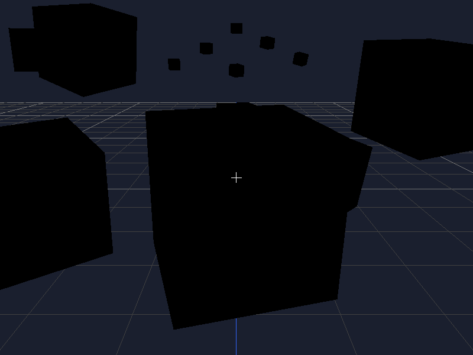

Қате түзетілді: әдепкіде MAG = `GL_LINEAR`, `glGenerateMipmap` шақырылады.

**Қорғауға: мұндай қатені қалай табар едім?**

* **`glGetError()`** MAG қатесінде көмектеседі, бірақ тек дәл сол
  `glTexParameteri`-ден **кейін** тексерсең және драйвер қатені қойса ғана.
  `glGetError` соңғы шақырудың емес, жиналған бірінші қатенің кодын
  қайтарады. Кадр соңында тексерсең, қайсы жол екенін білмейсің.
  Incomplete текстура жағдайында **мүлде көмектеспейді**: бұл қате емес,
  заңды күй.
* `glGetTexParameteriv(..., GL_TEXTURE_MAG_FILTER, ...)` арқылы нақты мәнді
  басып шығару (бағдарлама K басқанда осылай жасайды).
* Debug-контекст + `glDebugMessageCallback` (OpenGL 4.3 / `KHR_debug`).
  Драйвер қате мен ескертулерді бірден жазады.
* RenderDoc / apitrace арқылы кадрды түсіріп, текстураның күйі мен
  mipmap деңгейлерін көзбен көру.
* Шейдерде `FragColor = vec4(vTexCoord, 0.0, 1.0)` деп UV-ді түспен шығару.
  Куб түрлі-түсті болса, UV дұрыс, мәселе текстурада.

**Қара кубтың басқа себептері (кем дегенде үшеуі):**

1. MIN сүзгісінде mipmap тұрақтысы бар, бірақ `glGenerateMipmap` шақырылмаған
   (немесе `glTexImage2D`-ден **бұрын** шақырылған). Текстура incomplete.
2. Сурет жүктелмеді (жол қате, `assets/` ішінде жоқ). `glTexImage2D`
   шақырылмайды, текстура бос әрі incomplete.
3. Render циклінде текстура байланбаған немесе басқа бірлікке байланған:
   `glUniform1i(ourTexture, 1)`, бірақ `glActiveTexture(GL_TEXTURE0)`.
   Sampler бос бірлікті оқиды.
4. UV атрибуты қосылмаған (`glEnableVertexAttribArray(1)` жоқ). UV барлық
   жерде (0,0), бүкіл куб бір texel-дің түсімен боялады. Ол қара/қою болса,
   куб қара болып көрінеді.
5. Tint/түс uniform-ы орнатылмаған. Uniform әдепкіде 0, сонда
   `texture(...) * vec4(0,0,0,1)` = қара.

## 5-тапсырма: UV масштабы пернемен

Фрагмент шейдерінде `uniform float uvScale`, `texture(ourTexture, vTexCoord * uvScale)`.
`[` / `]` пернелері оны 0.5…8.0 аралығында өзгертеді. Үздіксіз әрекет
болғандықтан `dt`-ге көбейтілген (`uvScale += 2.0f * dt`).

`uvScale = 4.0`, GL_REPEAT: әр жақта сурет 4×4 рет қайталанады.

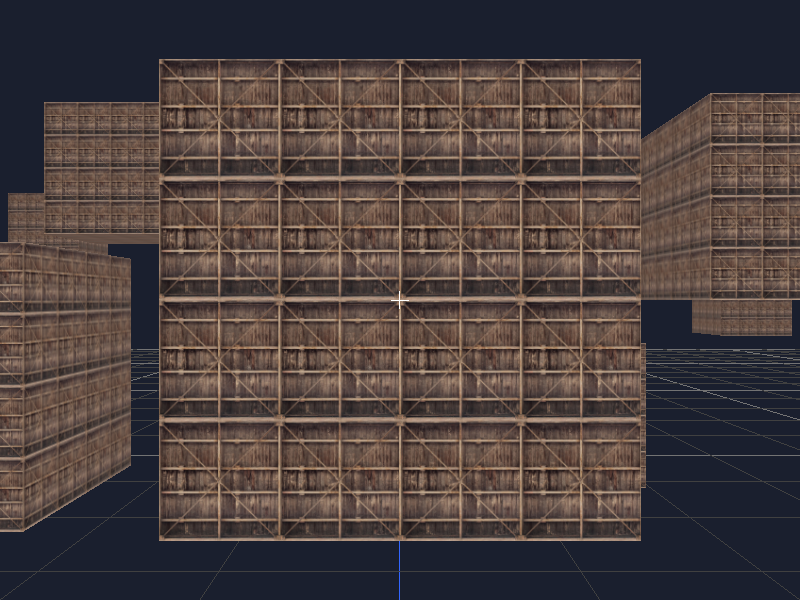

**Қорғауға: шейдерде көбейту мен `vertices[]` ішінде көбейтудің айырмашылығы.**

| | `vertices[]` ішінде | шейдерде (uniform) |
|---|---|---|
| Қашан есептеледі | бір рет, CPU-да, VBO жүктелгенде | әр кадрда, GPU-да, әр фрагментке |
| Жылдамдық | **жылдамырақ**: кадр сайын ешқандай есептеу жоқ | бір көбейту артық (қазіргі GPU үшін байқалмайды) |
| Өзгерту | VBO-ны қайта жүктеу керек (`glBufferData`/`glBufferSubData`), барлық объектіге бірдей әсер етеді | бір `glUniform1f`, кадр сайын да өзгертуге болады |
| Иілгіштік | төмен | **иілгішірек**: әр объектіге әр түрлі масштаб (бір VBO-мен), анимация |

Бұл жобада екеуі де бар: U пернесі `vertices[]`-ті өзгертеді
(`glBufferSubData` арқылы қайта жүктейді), ал `[ ]` uniform-ды өзгертеді. Еден
сол бір куб VBO-сымен сызылады, тек оған `uvScale × 40` беріледі. Мұны
`vertices[]` арқылы бір VBO-мен жасау мүмкін емес. Көбейтуді vertex
шейдеріне көшірсе, фрагмент сайын емес, вершина сайын (36 рет) есептеледі.
Ол одан да арзан.

## Қосымша тапсырмалар (орындалғандары)

* **Қ1. Өз суретім (O).** `assets/my-image.png`, 256×256, **4 арна** (бұрыштары
  мөлдір). Терминалда: `my-image.png  256x256  арна: 4`. `fmt` логикасы оны
  `GL_RGBA` ретінде жүктейді. Blending қосылмағандықтан мөлдір бұрыштар
  мөлдір болып көрінбейді, бұл 12-аптаның тақырыбы.
  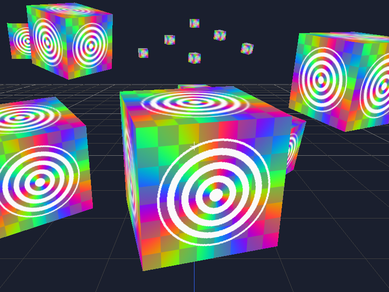
* **Қ2. Tint (T).** `FragColor = texture(...) * vec4(tint, 1.0)`. `tint` уақыт
  бойынша RGB шеңбері бойымен айналады.
  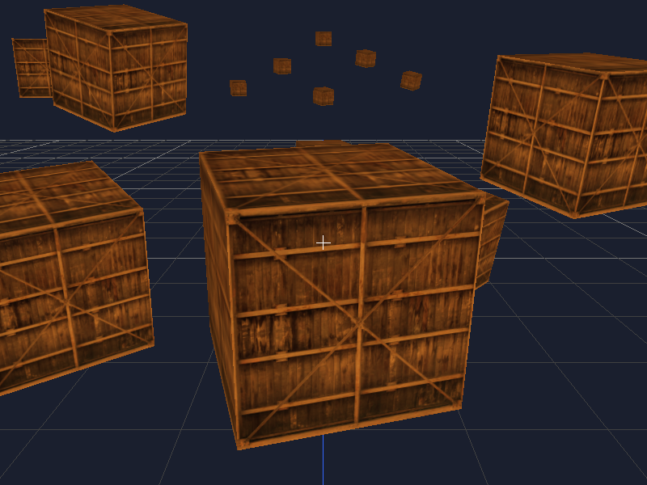
* **Қ3. Ағып жатқан су (F).** `uv + vec2(0.0, time * 0.1)`, GL_REPEAT-пен.
  Сурет кубтың бетімен үздіксіз жылжиды (қозғалыс болғандықтан скриншот жоқ).
* **Қ4. Анизотропты сүзгі (G + H).** `GL_MAX_TEXTURE_MAX_ANISOTROPY` = 16.
  Үлкен жалпақ кубқа (80 × 0.1 × 80) қиғаш қарағанда mipmap алыстағы еденді
  бұлдыратып жібереді. Анизотропиямен тақтайлар мен сызықтар алысқа дейін
  анық.

  | анизотропия жоқ | анизотропия 16× |
  |---|---|
  | 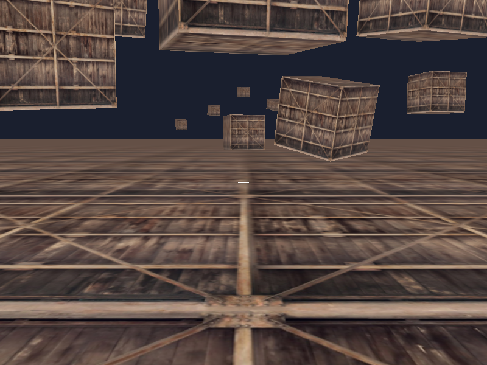 | 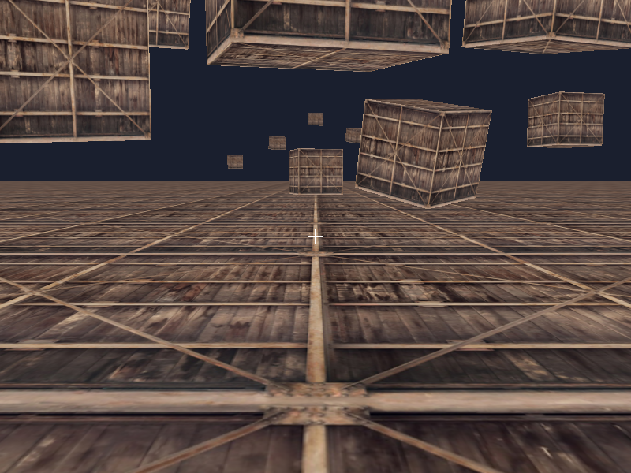 |

## Тексеру парағы

- [x] Терминалда сурет өлшемі мен арна саны жазылады
- [x] Кубтың алты жағында да сурет бар
- [x] Сурет төңкерілмеген
- [x] stride екі жерде де 5
- [x] `glGenerateMipmap` шақырылған
- [x] MAG сүзгісінде mipmap тұрақтысы жоқ (тек K пернесімен, әдейі)
- [x] `[` және `]` пернелері UV масштабын өзгертеді
- [x] 10 скриншот бар (+ қосымша тапсырмаларға 6)
- [x] `external/stb/stb_image.h` қосылған
- [x] README толтырылған
